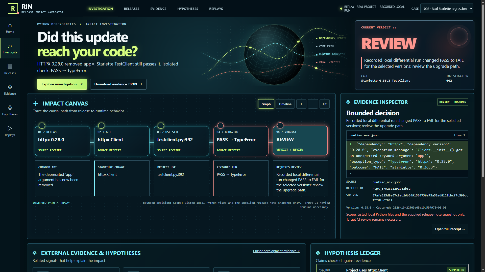
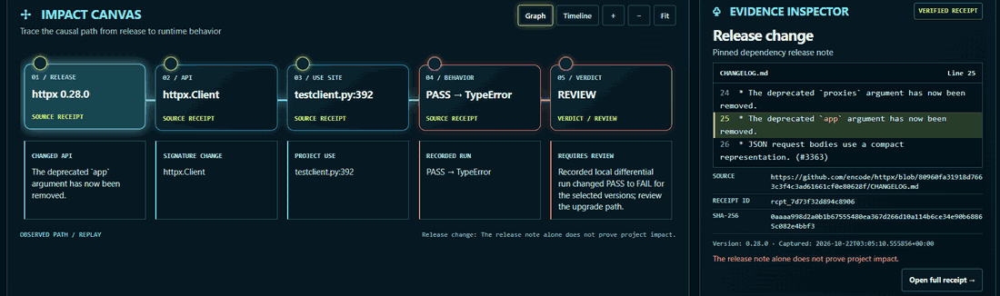
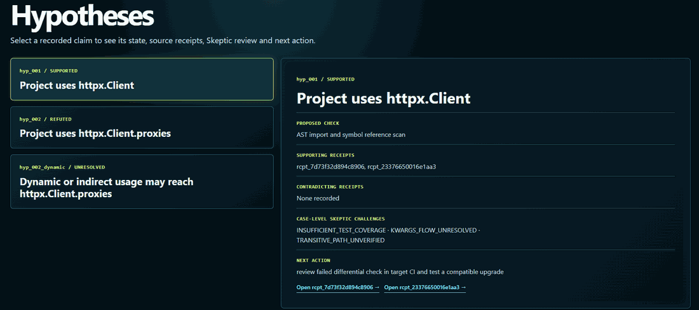
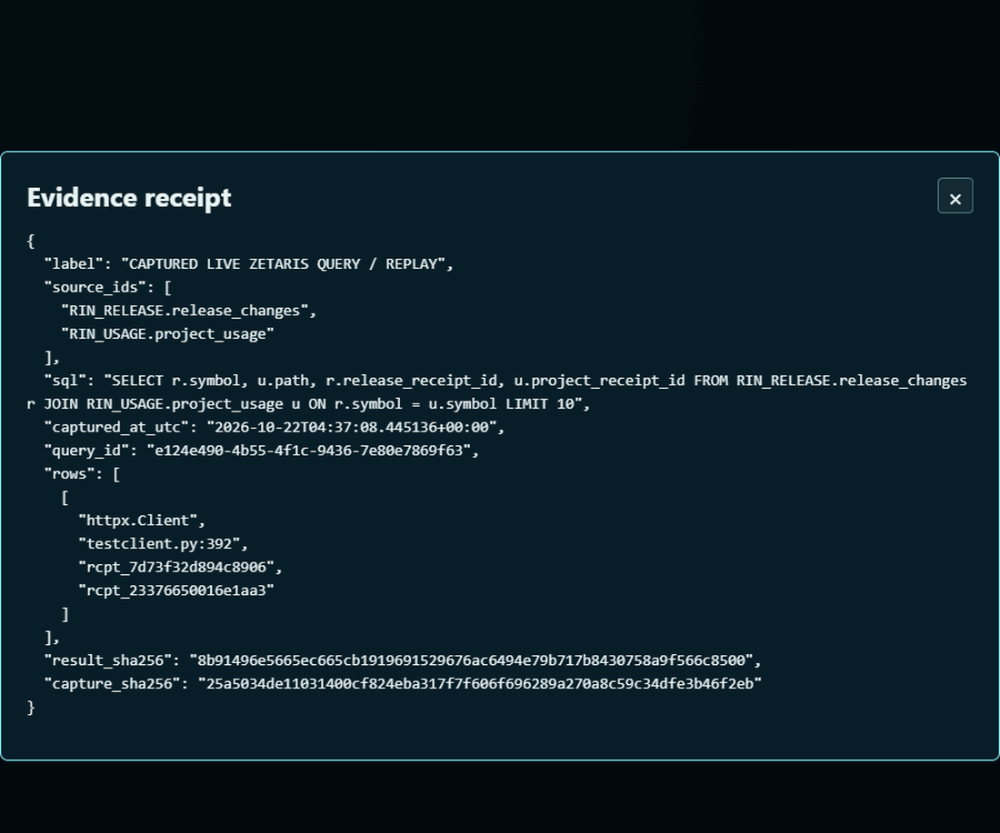
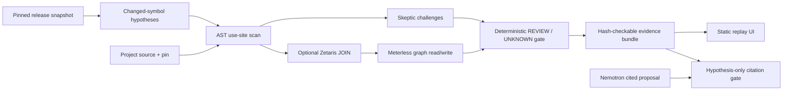

# RIN · Release Impact Navigator

### Did this update reach your code?

RIN investigates a Python dependency release against **your recorded project source**, follows the affected code path, and explains a bounded `REVIEW` or `UNKNOWN` with receipts. It is an evidence-first investigation console built for the [Open Agent Hackathon 2026, Track 02: The Agent That Can Explain Why](https://hackathon.genai.works/event/open-agent-hackathon-2026).



**Explore locally:** `python -m http.server 8000 --bind 127.0.0.1` → `http://127.0.0.1:8000/ui/`

**Presentation:** [seven-slide PDF](docs/RIN_JUDGE_SLIDES.pdf) · [110-second demo script](docs/DEMO_SCRIPT.md) · [static demo deployment guide](docs/HOSTING.md)
**Public demo and video:** URLs will be added only after an approved deployment and a checked playable recording. The UI currently displays **saved replay**, with no live sponsor calls.

<details><summary>On this page</summary>

- [Why RIN exists](#why-rin-exists)
- [A real regression, explained](#a-real-regression-explained)
- [Explore the investigation](#explore-the-investigation)
- [How evidence becomes a verdict](#how-evidence-becomes-a-verdict)
- [Sponsor technology, with receipts](#sponsor-technology-with-receipts)
- [Architecture and evidence model](#architecture-and-evidence-model)
- [Run and verify](#run-and-verify)
- [Limits and provenance](#limits-and-provenance)

</details>

## Why RIN exists

A changelog says **what changed in a package**. It cannot say whether a specific repository imports the affected symbol, forwards a removed argument, or behaves differently under the proposed version. RIN turns that gap into a traceable question:

> Release change → affected API → cited project use → recorded behavior → bounded decision.

The current prototype reads pinned release and project snapshots, checks dependency pins, scans Python AST usage, maintains testable hypotheses, records Skeptic challenges, and attaches SHA-256 source receipts. Its graph and optional model output help choose or explain checks; neither is allowed to invent proof.

## A real regression, explained

The primary case uses public **Starlette 0.36.3** source and **HTTPX 0.27.2 → 0.28.0**. The cited HTTPX release removed the deprecated `app` parameter. Starlette's `TestClient` inherits `httpx.Client` at `testclient.py:392` and passes `app=self.app` at line 430. A recorded isolated local constructor comparison changed **PASS → TypeError** for those selected versions. RIN returns **`REVIEW`** for this narrow path.

The 0.27.2 requirement is a **local reproduction pin**, not Starlette's upstream manifest. The result does not establish behavior of every Starlette application, deployment, or later version. [Inspect the six-receipt bundle](artifacts/starlette_httpx_028_bundle.json) or [read the source/behavior limits](LIMITATIONS.md).

## Explore the investigation

The UI has real Home, Investigation, Releases, Evidence, Hypotheses and Replays routes. Use the case selector to distinguish the public Starlette case from the explicitly synthetic Flask fixture. Browser Back/Forward, keyboard navigation, Graph/Timeline, Zoom/Fit, receipt viewers and JSON download work in the local replay.

| Investigation Canvas | Hypothesis Ledger |
|---|---|
|  |  |

Select the release, `httpx.Client`, `testclient.py:392`, the PASS→TypeError check, or `REVIEW`: the Inspector changes to its recorded source span, receipt ID, hash, provenance and limitation. In Hypotheses, `SUPPORTED` means the direct `httpx.Client` use was found; `REFUTED` applies to the direct `proxies` claim in the inspected source; `UNRESOLVED` keeps dynamic or indirect `proxies` paths open.

## How evidence becomes a verdict

1. **Propose:** turn a cited release span into a testable changed-symbol hypothesis.
2. **Intersect:** resolve imports and references in the listed Python files; attach project and release receipt IDs.
3. **Challenge:** inspect dynamic imports, forwarded `**kwargs`, transitive paths and source coverage. Preserve unresolved paths.
4. **Check behavior when recorded:** compare the pinned old/new local run and cite its two runtime receipts.
5. **Decide and verify:** the deterministic gate emits `REVIEW` or fail-closed `UNKNOWN`; `rin verify` recomputes receipt hashes, identities, spans and citations. Replay recomputes and compares the saved outcome.

`NO_ACTION` is intentionally rejected by the verifier: absence of a static match in a bounded snapshot is not proof that an application is safe to update. [Full architecture](ARCHITECTURE.md) · [Threat model and limits](LIMITATIONS.md).

## Sponsor technology, with receipts



| Technology | Actual contribution | Evidence and boundary |
|---|---|---|
| **NVIDIA Nemotron** | One actual NVIDIA-hosted `nvidia/nemotron-3.5-lightning-30b-a3b` response: HTTP 200, 516 usage tokens, two validated source citations. Its proposed impact remains **`HYPOTHESIS`**. | [Sanitized inference receipt](artifacts/nemotron_owner_key_inference_receipt.json) · [citation gate](src/rin/nemotron_optional.py). It does not determine `REVIEW`; opening the UI receipt makes no new inference call. |
| **Zetaris** | A previously executed bounded SQL JOIN across two registered local CSV sources returned **one** cited `httpx.Client` use at `testclient.py:392`. | [JOIN receipt](artifacts/zetaris_live_join_receipt.json) · [query-linked E2E receipt](artifacts/zetaris_live_e2e_receipt.json). This demonstrates two registered local sources, **not** heterogeneous remote federation. |
| **Meterless** | The World Model reference writes and reads an **in-memory** project/release/symbol graph and records `REVIEW_FAILED_DIFFERENTIAL_IN_TARGET_CI` as the next action. | [Graph and decision receipt](artifacts/zetaris_live_e2e_receipt.json) · [integration](meterless_graph.ts). No persistent production graph is claimed. |
| **Cursor** | A reviewed Agent change added a coverage challenge before the Skeptic snapshot and a regression test; local commit `e1cde63` and test result can be inspected. | [Development evidence](docs/CURSOR_AGENT_EVIDENCE.md). Original account Usage screenshots and task ID are not in this repository; Cursor is development provenance, not a runtime sponsor call. |

These are independent technology contributions, not sponsor endorsements. The live-captured SQL and hosted inference are **displayed in replay**. [Technical integration notes](SPONSOR_TECH.md).

## Architecture and evidence model



Let $\Delta$ be changed symbols supported by the pinned release snapshot and $U$ be symbol uses observed in the listed project source. The investigated intersection is

$$I = \Delta \cap U.$$

For each receipt $r$, local integrity requires its stored snapshot hash and cited span to match:

$$\operatorname{valid}(r) = [\operatorname{SHA256}(\operatorname{snapshot}_r)=\operatorname{hash}_r]\;\land\;[\operatorname{span}_r\subseteq\operatorname{snapshot}_r].$$

The implemented core returns `REVIEW` when a finding exists, the requested old-version pin matches, and no conflicting evidence was recorded; otherwise it returns `UNKNOWN`. A recorded PASS→FAIL differential strengthens the **case explanation** and next action. A Nemotron proposal is separately citation-checked and remains a hypothesis; it never becomes an independently validated fact or changes the core verdict. The graph contributes a recorded next action, not a substitute for source and runtime receipts.

## Run and verify

**Prerequisite:** Python 3.11+. The local UI and deterministic investigation need no package install, API key, Docker service or paid account. Node.js 22+ is needed only to replay the optional Meterless reference graph. Start from the repository root:

```powershell
python -m http.server 8000 --bind 127.0.0.1
# Open http://127.0.0.1:8000/ui/ in a browser.
```

In another terminal:

```powershell
python rin.py investigate samples/real_starlette/case.json --out artifacts/local_bundle.json
python rin.py verify artifacts/starlette_httpx_028_bundle.json
python rin.py replay samples/real_starlette/case.json artifacts/starlette_httpx_028_bundle.json
python -m unittest discover -s tests -v
python bench/capture_zetaris_live_e2e.py --replay
```

`investigate` recomputes the bundled source analysis; `verify` checks the shipped six source/runtime receipts; `replay` compares the recorded outcome. The sponsor `--replay` reads saved JOIN/graph evidence rather than querying Zetaris. To build the credential-free static website locally, run `python bench/build_static_demo.py` and serve `public_demo/`. [Deployment preparation](docs/HOSTING.md) explains the allowlist and hosting boundary.

The separate [development evaluation](artifacts/development_eval.json) contains a real public case, a synthetic fixture and a missing-release failure injection. It is **not** the frozen benchmark: **0 of 12 frozen cases have been evaluated**. The current local suite has 30 tests, including tamper rejection, false `NO_ACTION` rejection, citation failures and fail-closed `UNKNOWN`; no accuracy percentage is claimed.

## Limits and provenance

RIN trusts only the stated snapshots and captured local runs. SHA-256 detects local alteration; it does not authenticate an upstream publisher or guarantee complete source coverage. AST analysis can miss dynamic, generated or transitive behavior. The saved Zetaris capture is locally hash-checked, not service-signed. Meterless storage is in-memory. One successful Nemotron call is not a reliability study. No automatic dependency update is performed. [Limitations](LIMITATIONS.md) and [release notes](docs/RELEASE_NOTES_V4.md) describe the current threat and scope boundaries.

The project was developed during the recorded hackathon build window; earlier concept work, benchmark design and the pre-existing Apache-2.0 Meterless reference are disclosed in [development provenance](docs/PROVENANCE.md) and the [devlog](DEVLOG.md). The [official event page](https://hackathon.genai.works/event/open-agent-hackathon-2026) is the source for current rules. This repository is locally prepared; no public repository, hosted demo or submission is claimed yet.

RIN application code and UI are [MIT licensed](LICENSE). Vendored Meterless code retains its [Apache-2.0 license](vendor/meterless-world-model/LICENSE); upstream Starlette, HTTPX and Flask snapshots retain their included licenses. Thanks to the maintainers of those open-source projects and to the technology providers whose tools were used in the bounded investigation.
